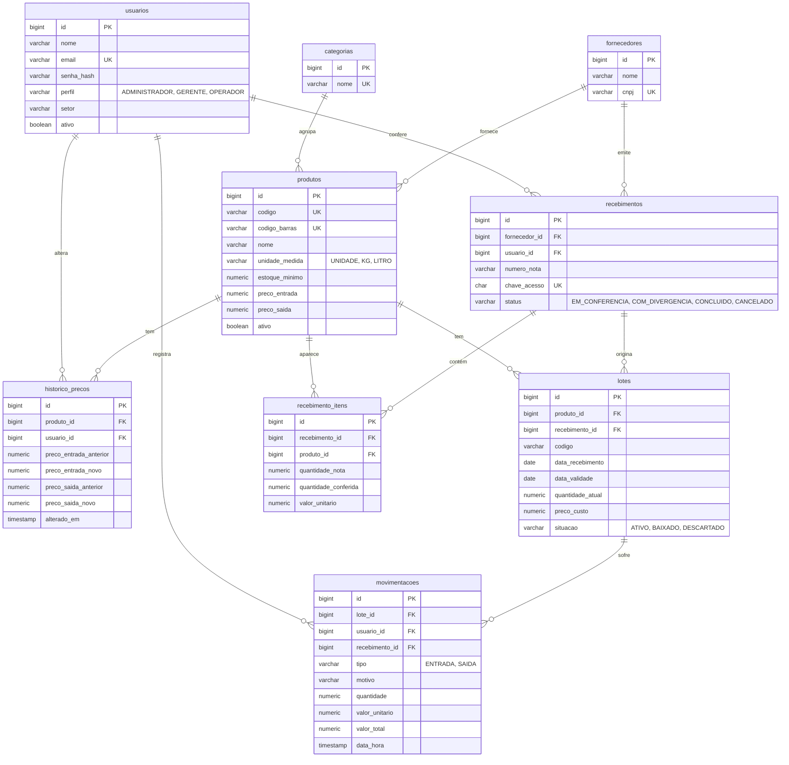

# Banco de dados

PostgreSQL 16. O schema é criado pelo Flyway a partir de
[`V1__schema_inicial.sql`](../backend/src/main/resources/db/migration/V1__schema_inicial.sql)
e segue o Documento de Requisitos (RF01 a RF10, RN01 a RN05).

Os modelos conceitual (notação de Chen) e lógico estão em
[`modelo-de-dados.drawio`](modelo-de-dados.drawio), que abre em [app.diagrams.net](https://app.diagrams.net).

## Diagrama

`configuracoes` (chave e valor) fica fora do diagrama porque não se liga a outras tabelas.

## Onde cada requisito fica no banco

| Requisito | Onde |
|---|---|
| RF01 Cadastro de produtos | `produtos`. Excluir é lógico (`ativo = false`), para não perder o histórico |
| RF02 Controle de estoque | `movimentacoes` atualiza `lotes.quantidade_atual`. O estoque do produto é a soma dos lotes (`vw_estoque_produto`) |
| RF03 Gestão de lotes | `lotes`, com `data_recebimento`, `data_validade` e `codigo` do lote |
| RF04 Registro de movimentações | `movimentacoes`, com usuário, data e hora, valor unitário e `valor_total` calculado pelo banco |
| RF05 Alertas | `vw_alertas`: estoque baixo, lote vencendo e lote vencido. O prazo de "vencendo" está em `configuracoes.dias_alerta_vencimento` (7) |
| RF06 Relatórios | Consultas sobre `movimentacoes` (o `motivo` separa venda, perda e vencimento) e `historico_precos` (variação de valores) |
| RF07 Usuários e login | `usuarios`, com perfil e setor |
| RF08 Controle de preços | `produtos.preco_entrada` e `preco_saida`, e cada mudança em `historico_precos` |
| RF09 Busca de produtos | Índices em nome, categoria e código; a busca por lote usa `lotes.codigo` |
| RF10 Área administrativa | Sem tabela própria; usa as anteriores e `configuracoes` |
| RN01 Estoque suficiente | O backend valida antes da saída. `CHECK (quantidade_atual >= 0)` impede saldo negativo |
| RN02 Lote vencido | `vw_alertas` sinaliza o lote; `situacao` registra baixa ou descarte; o backend bloqueia novas saídas |
| RN03 Usuário, data e hora | `usuario_id` e `data_hora` obrigatórios em `movimentacoes` |
| RN04 Preços só administrador ou gerente | Validado no backend; `historico_precos` guarda quem alterou |
| RN05 Relatórios só administrador ou gerente | Validado no backend |

## Decisões

- Quantidades em `NUMERIC(12,3)`, porque produto vendido por kg ou litro tem fração.
- Unidades de medida são as três do RF01: `UNIDADE`, `KG` e `LITRO`.
- As regras que dependem do perfil do usuário (RN04, RN05) ficam no backend. O banco garante as que não dependem (RN01 e RN03).
- O recebimento pela nota (telas 11 a 14 do protótipo) tem `recebimentos` e `recebimento_itens`. A divergência é a diferença entre `quantidade_nota` e `quantidade_conferida`.
